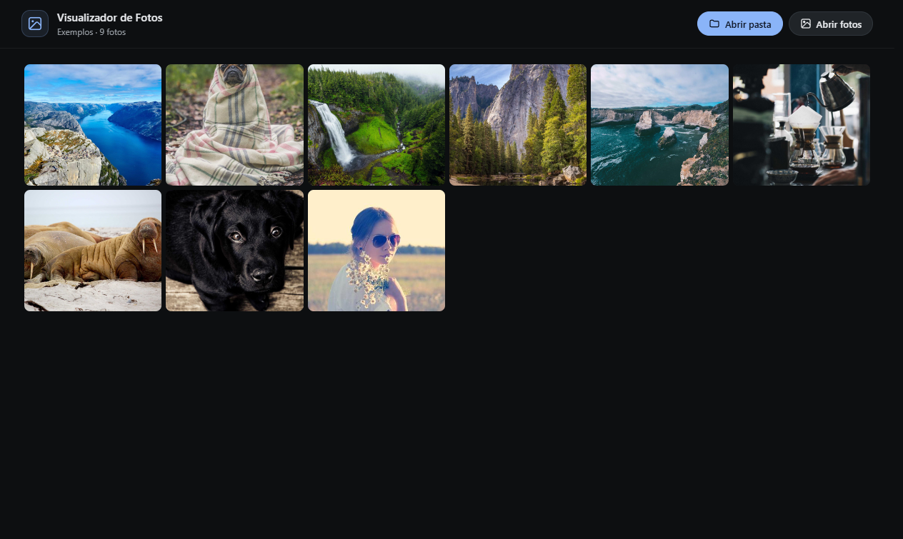
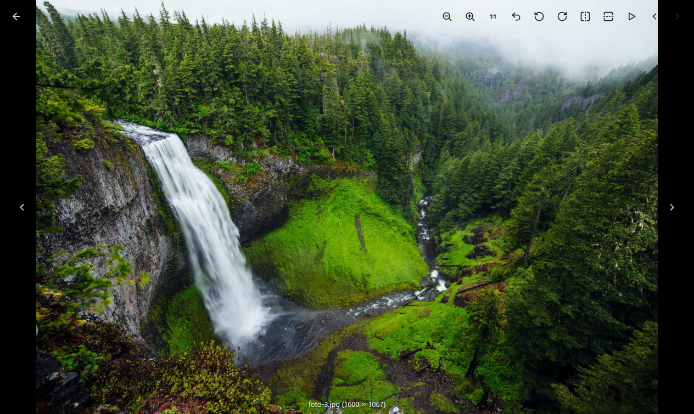

# Visualizador de Fotos

[](#requisitos)
[](LICENSE)
[](https://github.com/fengyuanchen/viewerjs)

Aplicativo desktop local para Windows que abre suas fotos com uma interface de
visualizador em tela cheia: fundo preto, imagem encostada nas bordas, controles
flutuantes discretos e transição horizontal rápida entre fotos.

O projeto reúne o **aplicativo Electron** e o **tema reutilizável para ViewerJS** no
mesmo repositório. Nenhum asset, ícone ou texto do Google Fotos é usado.





## Recursos

- Abre a pasta **Imagens** do Windows por padrão (ou a pasta/arquivo passado na linha de
  comando).
- Abre uma pasta inteira ou uma seleção de fotos, com miniaturas rápidas em cache.
- Arrasta e solta pastas ou arquivos na janela.
- **Transição horizontal rápida (200 ms)**: a foto atual desliza para fora enquanto a
  próxima entra pelo lado oposto.
- Navegação por setas laterais, teclado, roda do mouse e swipe.
- Zoom, 1:1, reset, rotação, espelhamento, slideshow e tela cheia.
- Contraste automático dos ícones: ficam escuros sobre fotos claras e claros sobre fotos
  escuras.
- Modo offline: o ViewerJS e o tema são servidos localmente; nenhuma foto sai do
  computador.
- Limite de 3.000 imagens por abertura e leitura do nível superior da pasta.

## Download

O instalador `.msi` será publicado em **Releases** após a aprovação da assinatura de
código no [SignPath Foundation](https://signpath.org/). Acompanhe o status em
[docs/SIGNING.md](docs/SIGNING.md).

Enquanto isso, o MSI pode ser gerado localmente (não assinado):

```bash
npm install
npm run dist
# dist/Visualizador-de-Fotos-1.0.1-x64.msi
```

O MSI tem cerca de 121 MB e **não é versionado no repositório** — o GitHub bloqueia
arquivos acima de 100 MB. Instaladores vão para os Releases.

## Requisitos

- Windows 10/11 x64.
- Para desenvolver/compilar: Node.js 20+ e npm.

## Desenvolvimento

```bash
npm install
npm start
```

O comando `start` sincroniza automaticamente o tema de `theme/` para `app/vendor/`
antes de abrir o aplicativo.

## Estrutura

```text
electron/                  processo principal, preload, protocolo viewer:// e menus
app/                       interface da galeria, estilos e vendor do ViewerJS
  vendor/                  ViewerJS 1.15.2 + cópia sincronizada do tema
theme/                     tema viewerjs-gphotos reutilizável (CSS, JS, demo, ícones)
scripts/sync-theme.js      sincroniza theme/ -> app/vendor/ antes do build
build/                     ícone do aplicativo e do instalador
docs/screenshots/          imagens usadas neste README
docs/SIGNING.md            plano e status da assinatura do MSI
.github/workflows/         build do MSI no GitHub Actions
```

### Tema para ViewerJS

A pasta [`theme/`](theme/) pode ser usada em qualquer projeto web com ViewerJS:

```html
<link rel="stylesheet" href="viewer.min.css">
<link rel="stylesheet" href="viewerjs-gphotos.css">

<script src="viewer.min.js"></script>
<script src="viewerjs-gphotos.js"></script>
<script>
  createGPhotosViewer(document.getElementById('galeria'));
</script>
```

Abra `theme/demo.html` para ver o tema isolado, com variações de miniaturas e título.

## Como as imagens são servidas

A página e as fotos usam o protocolo interno `viewer://local/...` (registrado como padrão
e seguro). Isso mantém a mesma origem para a página e para as imagens, permitindo que o
tema amostre a luminância no canvas e alterne os ícones entre claros e escuros sem
depender de um servidor HTTP local.

Miniaturas de 480 px são geradas sob demanda com
`nativeImage.createThumbnailFromPath` e ficam em cache na memória; o visualizador sempre
abre o arquivo original.

## Transição entre fotos

Ao navegar, a foto atual é clonada numa camada sobre o canvas, a próxima é carregada por
baixo e, quando estiver pronta, as duas deslizam juntas na horizontal em 200 ms.

Para ajustar em `app/styles.css`:

```css
.viewer-container {
  --vjs-slide-duration: 200ms;
  --vjs-slide-distance: 100vw;
  --vjs-slide-distance-negative: -100vw;
}
```

## Build e assinatura

- `npm run dist` gera o instalador MSI por usuário (sem exigir administrador).
- O electron-builder baixa o WiX automaticamente no primeiro build.
- A assinatura de código está planejada via SignPath Foundation; veja
  [docs/SIGNING.md](docs/SIGNING.md).
- O workflow de CI compila o MSI sem assinatura a cada push em `main` e disponibiliza o
  artefato no Actions.

## Limitações

- Lê apenas o nível superior da pasta (subpastas não são incluídas).
- Limite de 3.000 imagens por abertura.
- Formatos: JPG, JPEG, PNG, GIF, WEBP, BMP, AVIF, SVG e ICO.
- Sem edição, envio para a nuvem, favoritos ou reconhecimento de conteúdo.

## Créditos e licença

- Código do aplicativo e do tema: MIT © 2026 **Emanuellscheifler**.
- [ViewerJS](https://github.com/fengyuanchen/viewerjs), de Chen Fengyuan: MIT.
- [Electron](https://github.com/electron/electron): MIT.
- Fotos de demonstração: [Lorem Picsum](https://picsum.photos) / Unsplash, apenas para
  demonstração.
- Avisos completos em [THIRD-PARTY-NOTICES.md](THIRD-PARTY-NOTICES.md).

Google Photos é uma marca da Google LLC. Este projeto não é afiliado ao Google.
